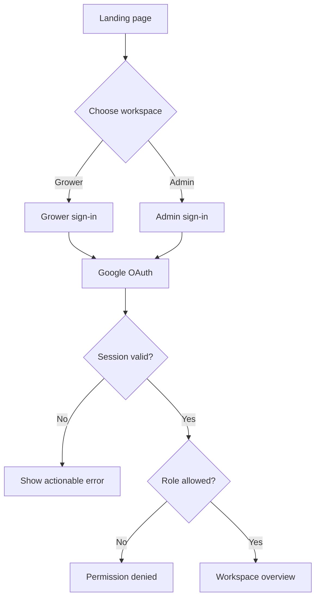
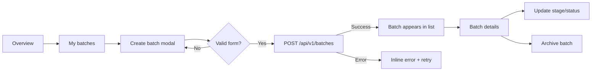

# Application Flow

## 1. Visitor to workspace



## 2. Grower batch flow



## 3. Data request states

Every request follows:

```text
idle → loading → success
             ↘ empty
             ↘ error → retry
offline ───────────────────────┘
```

The interface must distinguish an empty account from an unavailable API and
must not display placeholder values as live measurements.

## 4. Future device flow

```text
Device boot → validate configuration → sample locally → validate event
  → queue if offline → publish → API validates → persist → acknowledge
  → dashboard refresh
```

Actuator commands follow the reverse path only after authorization, expiry,
idempotency, interlock, and emergency-stop rules are implemented.
