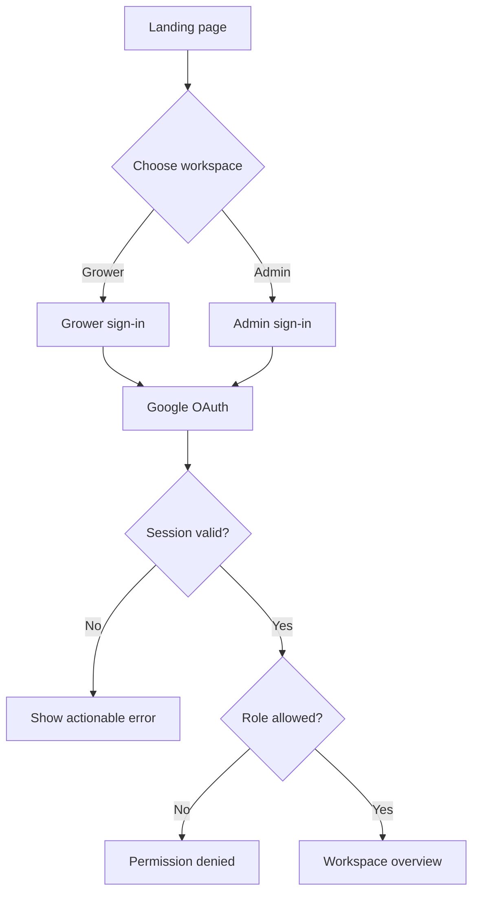
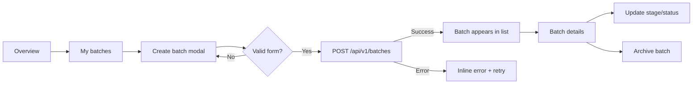
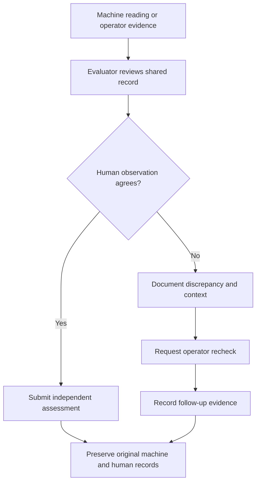
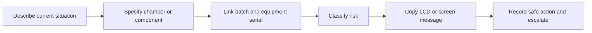
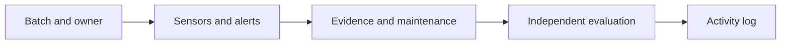

# Application Flow

## 1. Visitor to workspace



## 2. Operator batch flow



## 3. Data request states

Every request follows:

```text
idle → loading → success
             ↘ empty
             ↘ error → retry
offline ───────────────────────┘
```

The interface must distinguish an empty account from an unavailable API and
must not display placeholder values as live measurements.

## 4. Future device flow

```text
Device boot → validate configuration → sample locally → validate event
  → queue if offline → publish → API validates → persist → acknowledge
  → dashboard refresh
```

Actuator commands follow the reverse path only after authorization, expiry,
idempotency, interlock, and emergency-stop rules are implemented.

## 5. Evaluation disagreement flow



An evaluation is a human judgment, not a correction to telemetry. The UI keeps
source, actor, and timestamp visible so a later review can explain why the
records differed.

## 6. Current-situation and SOP flow



The UI includes this flow as a non-persisted draft until an incident contract,
owner, notification destination, and audit policy are implemented. It must not
claim that a report was submitted or that physical equipment was made safe.

## 7. Record tracking map



Every detail view should preserve the batch, owner, source, and timestamp needed
to follow this path. Evaluators may receive records from multiple operators, so
operator context remains visible in batch and evaluation filters.

## 8. Identity correction and access setup

- A completed account name is read-only. A correction starts from the support
  entry point and is not silently changed in profile settings.
- Email changes remain disabled until verified change-email behavior exists.
- Admin IT registers equipment and provisions operators.
- Evaluator invitations require delivery and acceptance tracking before the UI
  can present them as available.
- The account menu is the single profile and sign-out destination on the web.

## 9. Open terminology

`CBA × 365` was included in panel notes but has no defined product meaning or
workflow. It must not appear as a UI label until the panel supplies its full
name, intended user, data, and expected action.
