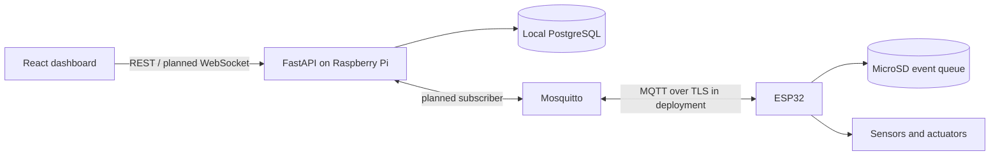

# Architecture

The SDP defines two controllers: the ESP32 owns time-sensitive sensing, sequential irrigation, safety interlocks and MicroSD event buffering. A Raspberry Pi 4 hosts supervisory FastAPI, PostgreSQL and Mosquitto services. The browser is a responsive operator interface.

PostgreSQL is the application database. Local Compose PostgreSQL is the
default for offline development; Supabase PostgreSQL can be selected with
`DATABASE_URL` for hosted development. Supabase must not become a dependency
of local irrigation.

No AI service, mobile app or multiple admin portals are specified in the SDP, so those reference-image modules are not included.

Production boundaries: add device credentials, MQTT security, and production
TLS with per-device ACLs before network deployment. Anonymous MQTT in Compose
is loopback-only development configuration. Deployment certificates, secrets
and volumes must stay outside Git.

Implemented API foundation: Supabase Auth bearer-token verification,
PostgreSQL-backed local user projection, `/auth/me`, and Alembic identity
migrations. Proposed next API modules: devices, batches, trays, telemetry,
irrigation, alerts, yield, reports and audit. Introduce modules as their first
vertical slices are implemented instead of creating empty layers.

Unresolved: actual board variant, sensors, GPIO mapping, relay polarity, limits, irrigation timings, retention, roles, cloud synchronization and final UI screens. None should be inferred from the scaffold.
