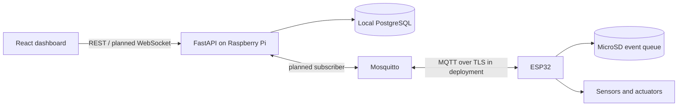

# Architecture

The SDP defines two controllers: the ESP32 owns time-sensitive sensing, sequential irrigation, safety interlocks and MicroSD event buffering. A Raspberry Pi 4 hosts supervisory FastAPI, PostgreSQL and Mosquitto services. The browser is a responsive operator interface.

Local PostgreSQL is the scaffold default because the control system must operate without internet. Supabase is an SDP managed option; optional synchronization requires a separate design, conflict handling and recovery tests. It must not become a dependency of local irrigation.

No AI service, mobile app or multiple admin portals are specified in the SDP, so those reference-image modules are not included.

Production boundaries: add authenticated API access, device credentials, MQTT TLS and per-device ACLs before network deployment. Anonymous MQTT in Compose is loopback-only development configuration. Deployment certificates, secrets and volumes must stay outside Git.

Proposed API modules: identity, devices, batches, trays, telemetry, irrigation, alerts, yield, reports and audit. Introduce modules as their first vertical slices are implemented instead of creating empty layers.

Unresolved: actual board variant, sensors, GPIO mapping, relay polarity, limits, irrigation timings, retention, roles, cloud synchronization and final UI screens. None should be inferred from the scaffold.

