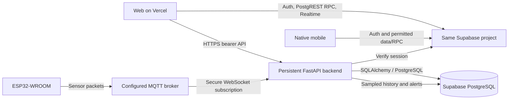

# Backend API, Swagger and deployment checks

The backend publishes its live contract from the implemented FastAPI routes.
It documents request fields/examples, response models, access requirements,
status codes and the effect of each operation. No separate generated endpoint
list needs to be uploaded to a Swagger service.

| Address on the backend | Purpose |
| --- | --- |
| `/docs` | Interactive Swagger UI: filter operations, authorize and make requests |
| `/redoc` | Readable reference using the same schema |
| `/openapi.json` | Downloadable OpenAPI schema for Postman/other API clients |
| `/api/v1/health` | Public process liveness; database and MQTT are not probed |
| `/api/v1/ready` | Public, redacted database and migration readiness; 200 or 503 |
| `/api/v1/system/connections` | Protected superadmin/admin service diagnostics |

Locally, open **http://localhost:8000/docs**. After deployment, use the same paths
on the actual HTTPS backend origin, for example `https://api.example.com/docs`.
Port 5173 is the web frontend; its development proxy forwards `/api` only.
Swagger uses the backend serving its schema, so it does not silently send deployed
requests to localhost. The existing `/health` and `/` liveness aliases still work
but are hidden from the canonical API documentation.

## Try an endpoint

1. Run the backend, open `/docs`, expand **health** and execute `GET /api/v1/health`.
2. Execute `GET /api/v1/ready`. `status: ready` with both checks `ok` means the
   database can answer a read-only query and its migration stamp matches this
   backend release. `503` means it cannot yet serve its database-backed workflows.
3. Sign in to the SproutSync web app with your intended development account.
   Obtain **your own current Supabase session access token**, for example from
   the Authorization header of your browser's authenticated API request in
   developer tools. Do not copy someone else's token or commit/store it in `.env`.
4. Click **Authorize** in Swagger, paste the token **without** the `Bearer ` prefix,
   and authorize. A Supabase public anon key, service-role key, database password
   or MQTT password is not a user access token.
5. Execute `GET /api/v1/auth/me` to confirm your role. Then use permitted read
   endpoints. Superadmins can execute `GET /api/v1/system/connections`.
6. Use Swagger **Logout** when finished. Authorization persistence is disabled;
   refreshing the page requires authorizing again. Renew an expired token from
   the signed-in application.

Swagger executes real operations. POST/PATCH/DELETE may change records or access;
the verification-send endpoint can send email. It does not simulate them. IDs and
discovery tokens must come from your permitted records/current discovery results.
Replace example report UUIDs for new reports, preserving the UUID only on a retry.

## What the connections mean



| Diagnostic check | What `ok` establishes | What it does not establish |
| --- | --- | --- |
| `database` | Read-only database query succeeded | Every write workflow or policy is correct |
| `schema` | Alembic version stamp matches this release | Every table/column/policy was independently audited |
| `supabase_auth` | Supabase Auth health endpoint returned 200 | Google OAuth, email delivery or a particular token works |
| `supabase_rest` | Zero-row metadata GET returned the expected PostgREST permission denial (`42501`) | A user's RLS grant, RPC execution or Realtime subscription works |
| `mqtt` | This backend process reports connected broker state without a subscription error | ESP32 is powered on, matching packets arrived, or measurements are accurate |
| `smtp` | Never marked `ok` by this check | It is configuration-only: `not_checked` or `not_configured`; no email is sent |

Diagnostics returns HTTP **200** when the inspection itself succeeds, with
`status: ok` or `degraded` and per-check results. A failed required check makes it
degraded. SMTP is optional; disabling MQTT explicitly reports `disabled` and does
not pretend it is connected. Operators/evaluators use their authorized
`devices/live` snapshot rather than this administrative inspection endpoint.
Broker URLs, passwords, client keys and personal records are omitted from
diagnostics. Supabase Realtime and physical sensor operation need separate checks.

The database probe uses a separate nonpooled read-only connection, a three-second
connection timeout and a two-second statement timeout. One result is shared for
ten seconds to avoid a database connection per monitoring request; `checked_at`
shows when it was taken. Network/DNS behavior can add overhead to driver timeouts.
The public HTTP response is `Cache-Control: no-store`. Auth/Data API probes run
concurrently with three-second HTTP timeouts and do not follow redirects. The
Data API probe requests `/rest/v1/alembic_version?select=version_num&limit=0` using
the public client key; 401/403 with PostgREST code `42501` is the expected protected
response. A generic invalid-key 401, public access returning 200, or a service
failure does not pass. No migration stamp or user record is retrieved. This avoids
assuming anonymous access to the project's OpenAPI root is enabled.

## Endpoint inventory

The complete current fields and schemas are in `/docs`. This inventory explains
how each FastAPI operation is used. `O+` means operator/admin/superadmin; `A` means
superadmin/admin. Every authenticated request also requires a verified-email,
active Supabase identity. Ordinary operators cannot read another operator's
records by guessing an ID.

| Method and path | Access | Use and effect |
| --- | --- | --- |
| `GET /api/v1/health` | Public | Process liveness only; always independent of DB/broker state |
| `GET /api/v1/ready` | Public | Database/schema checks; no repair or data writes |
| `GET /api/v1/system/connections` | A | Read-only service diagnostics described above |
| `GET /api/v1/auth/me` | Signed in | Verify session and return local profile/role; may sync the caller's identity projection |
| `POST /api/v1/auth/profile` | Signed in | Save caller's name/organization/phone and profile completion |
| `POST /api/v1/auth/verify/send` | Signed in | Optional local OTP; already verified/cooldown can return 200 without sending |
| `POST /api/v1/auth/verify/confirm` | Signed in | Optional local OTP confirmation; incorrect/expired code 400, lockout 429 |
| `GET /api/v1/batches` | Signed in | Own operator batches, granted evaluator batches, or admin fleet; pending gets empty list |
| `POST /api/v1/batches` | O+ | Save a real batch owned by the caller; 201 |
| `PATCH /api/v1/batches/{batch_id}` | O+ | Change submitted lifecycle fields on a caller-owned batch; foreign/missing ID 404 |
| `POST /api/v1/batches/{batch_id}/archive` | O+ | Archive caller-owned batch while preserving history |
| `GET /api/v1/devices/discover` | O+ | Scan backend host's LAN for advertised SproutSync identities; no registration |
| `POST /api/v1/devices/nearby` | O+ | Register current Wi-Fi selection or client-read BLE identity; 202 pending, expired Wi-Fi token 410 |
| `POST /api/v1/devices/connect` | O+ | Bind an assigned serial to a unique firmware topic; 202 pending, conflict 409 |
| `GET /api/v1/devices/live` | Signed in | Scoped device states, this process's broker state, saved history, current packets and provisional minute averages |
| `POST /api/v1/devices/{device_id}/issues` | O+ | Save human observation, alert and audit event; report UUID deduplicates unchanged retries |
| `POST /api/v1/access-requests` | Signed in | Intended for unassigned users; handler accepts any active account; saves pending request, does not grant access |
| `GET /api/v1/operator/evaluators` | O+ | Return evaluator account summaries linked to the caller's grants |
| `PATCH /api/v1/operator/evaluators/{evaluator_id}` | O+ | Edit permitted evaluator profile/email, not role |
| `GET /api/v1/operator/access-requests` | O+ | Return pending requests directed to caller's own account |
| `POST /api/v1/operator/access-requests/{request_id}/approve` | O+ | Authorize request, promote requester and save/update evaluator grant/audit |
| `POST /api/v1/operator/access-requests/{request_id}/decline` | O+ | Save declined decision/audit; does not itself revoke an existing grant |
| `GET /api/v1/superadmin/accounts` | A | Fleet accounts, pending users, assigned serials and evaluator summaries |
| `PATCH /api/v1/superadmin/accounts/{user_id}` | A | Edit profile/role with last-superadmin guard; optional Auth email sync is separate |
| `DELETE /api/v1/superadmin/accounts/{user_id}` | A | Permanently delete eligible local account/access associations; production history blocks deletion |
| `POST /api/v1/superadmin/device-grants` | A | Assign serial; transferring a device with telemetry history is blocked |
| `POST /api/v1/superadmin/assign-evaluator` | A | Create/update evaluator assignment and administrative audit entry |

Batch/account lists are currently unpaginated. Device history is bounded to
1,000 saved history rows (legacy raw, state events, minute/five-minute averages). Omit `after_id` for newest-first history; supply the
largest processed ID to recover subsequent saved rows in ascending order.
`after_id` does not filter current cached packets. An empty authorized list is
a valid result, not evidence that the endpoint is broken.

Supabase also exposes APIs used directly by the clients. These are **not**
FastAPI paths and should not be duplicated or called with the backend host:

| Supabase interface | Current use |
| --- | --- |
| `/auth/v1/*` | Sign-in, token refresh, identity/provider handling through Supabase clients |
| `/rest/v1/*` | RLS-scoped workspace records, including batches/readings/alerts/evaluations/schedules |
| `/rest/v1/rpc/ensure_profile` | Local profile projection for a signed-in Supabase identity |
| `/rest/v1/rpc/save_profile` | Client profile completion |
| `/rest/v1/rpc/initialize_workspace` | Existing workspace initialization; automatic demo seeding is disabled |
| `/rest/v1/rpc/search_workspace` | Bounded global record search with the caller's RLS permissions |
| `/rest/v1/rpc/workspace_live_snapshot` | Authorized durable current packets, provisional minute means and history; foreground web polling every two seconds |
| `/rest/v1/rpc/grant_evaluator_access` | Operator grants by normalized account email; repeat requests return `already_granted=true` without duplicate rows |
| `/rest/v1/rpc/operator_list_evaluators` | Caller-owned grants, including accounts that have not registered yet |
| `/rest/v1/rpc/operator_list_access_requests` | Caller-owned pending requests |
| `/rest/v1/rpc/operator_approve_request`, `/operator_decline_request` | Authorized, retry-safe decisions; approval preserves other operators' grants |
| `/rest/v1/rpc/request_operator_access` | Submit a request to the specified operator |
| Supabase Realtime | Authorized change subscriptions; HTTP readiness does not test a subscription |

Use Supabase SDKs and existing RLS policies for these calls. Other legacy SQL
RPCs exist in migrations; their existence does not mean current clients use or
support them. See the [database security review](database-security-review.md).

The operator grant/list/decision screens now call these Supabase RPCs directly.
They do not require a same-origin Vercel `/api/v1/operator/*` rewrite. Live
snapshots prefer a configured FastAPI backend, falling back to the scoped
Supabase RPC if that backend is unavailable. With no backend URL on a hosted
frontend, the RPC is used directly. This fallback still needs a running MQTT
collector to write current packets; Supabase does not subscribe to MQTT itself.
Swagger lists FastAPI routes; the table above documents the separate Supabase
interfaces and their role in the browser flow.

## Read-only deployment checker

`scripts/check_backend.py` uses Python's standard library and works on Windows
and Linux without installing additional packages. From the repository root:

```powershell
py -3 scripts/check_backend.py --base-url http://127.0.0.1:8000
py -3 scripts/check_backend.py --base-url https://YOUR-BACKEND-HOST --json
```

On Linux, use `python3` instead of `py -3`. The checker reports PASS/FAIL/SKIP for
liveness, readiness, Swagger, schema and anonymous access denial. It exits with
code 1 on failure and 0 if performed checks passed. SKIP is **not** a successful
test of the skipped capability. `--timeout` sets each HTTP request timeout.

To include permitted authenticated reads, put a current session token in the
temporary process environment variable `SPROUTSYNC_ACCESS_TOKEN`. Do not pass a
token on the command line, paste it into a committed script or save it as an app
deployment secret. A PowerShell prompt avoids putting the token in shell history:

```powershell
$sproutSessionToken = Read-Host 'Your Supabase session access token' -AsSecureString
$env:SPROUTSYNC_ACCESS_TOKEN = [Net.NetworkCredential]::new('', $sproutSessionToken).Password
try {
    py -3 scripts/check_backend.py --base-url https://YOUR-BACKEND-HOST
} finally {
    Remove-Item Env:\SPROUTSYNC_ACCESS_TOKEN
    $sproutSessionToken.Dispose()
}
```

Authenticated checks add `auth/me`, permitted batch/device reads and MQTT state.
A superadmin/admin token additionally checks individual required service states.
The script does not print account responses, tokens or secrets, follow redirects,
scan LAN devices, send email, register devices, create records or operate equipment.
Normal authentication can sync the current user's local identity projection.
Remote authenticated checks require HTTPS; HTTP is accepted only on loopback.

## Backend deployment setup

Deploy this as a persistent Python/container web service capable of background
threads and outbound MQTT WebSockets. Keep **one Uvicorn worker and one service
replica** with the current bridge architecture: it maintains MQTT subscriptions,
sampling/deduplication state, discovery selections and latest packets in process.
Multiple replicas would create multiple independent subscribers/caches. Split
ingestion into a dedicated coordinated service before scaling API replicas.
Do not host this continuous bridge as a short-lived frontend/serverless function.
An idle-sleeping/free service can stop ingestion; no plan here guarantees 24/7
telemetry or packet replay while it sleeps. Device buffering/replay needs its own
firmware/server agreement and hardware validation.

The repository already contains `backend/api/Dockerfile` and an entrypoint that
validates Supabase prerequisites, applies reviewed Alembic migrations and starts
Uvicorn on `0.0.0.0:${PORT:-8000}`. A Docker-capable host can use:

| Deployment setting | Value |
| --- | --- |
| Docker build context / root directory | `backend/api` |
| Dockerfile inside that context | `Dockerfile` |
| Start command | Existing container entrypoint; no override required |
| Runtime | Python 3.12+ supplied by the image |
| Liveness path | `/api/v1/health` |
| Readiness path | `/api/v1/ready` |
| Instances/workers | One instance, one Uvicorn worker |
| HTTP port | Host-provided `PORT`, default 8000 |

For a native Python host, install `./backend/api` from the repository root, set
the working directory to `backend/api` and run `sh docker-entrypoint.sh`. It uses
the same prerequisite/migration/start sequence as the image. Review/back up the
target database before a deployment that advances its schema; never run production
upgrades against a project selected by guesswork.

Set these through the backend host's secret/environment settings, not Vercel's
public browser variables:

| Backend variable | Requirement |
| --- | --- |
| `DATABASE_URL` | Matching Supabase PostgreSQL `postgresql+psycopg://...` URL; use project's appropriate connection/pooler and SSL settings |
| `SUPABASE_URL`, `SUPABASE_ANON_KEY` | Same Supabase project as frontend/native; server uses public key to verify user sessions |
| `FRONTEND_URL` | Actual HTTPS Vercel frontend origin for CORS |
| `MQTT_ENABLED` | `true` when IoT ingestion is required; false is an explicit disabled state |
| `MQTT_BROKER_URL` | Actual firmware broker's `wss://.../mqtt` URL; no embedded credentials |
| `MQTT_USERNAME`, `MQTT_PASSWORD` | Backend broker account with subscription ACLs; never browser secrets |
| `MQTT_STALE_SECONDS` | Optional device freshness threshold, default 30 seconds; separate from this process's broker status |
| `DEVICE_ID` | Optional logging/client-ID label; does not assign ownership |
| `SUPABASE_SERVICE_ROLE_KEY` | Optional server-only Auth email synchronization; not needed for Swagger user authentication |
| SMTP variables | Optional local verification endpoint; distinct from Supabase Auth email configuration |

History cadence is fixed at five-minute UTC windows, switching to one-minute
averages for any window containing a fault. `TELEMETRY_SAMPLE_SECONDS` is a
legacy setting and is ignored. See the [aggregation contract](telemetry-and-usability.md).
Use one persistent MQTT collector process, with one Uvicorn worker. The shared
`device_live_state` survives process restarts and is readable through RLS-scoped
snapshots; it is not a queue and cannot replay packets lost while no collector
was running. Running only the Vercel frontend does not keep IoT ingestion alive.

In Vercel set `VITE_API_URL=https://YOUR-BACKEND-HOST` and the matching public
`VITE_SUPABASE_URL`/`VITE_SUPABASE_ANON_KEY`, then rebuild/redeploy the frontend.
Keep `/api/v1` out of `VITE_API_URL`; callers already supply it. Native builds
currently access Supabase directly using their compiled Supabase configuration;
`VITE_API_URL` changes do not update an installed Android app. Keep Supabase Auth redirect allowlists aligned with actual web
and mobile callbacks. Check CORS using the real frontend origin after deployment.

Cloud mDNS discovery will not cross into a user's private LAN. Use an existing
assigned serial/topic binding or the supported client's identity-read flow;
neither grants the backend access to arbitrary local Wi-Fi/Bluetooth devices.
The deployment checker never triggers discovery as a side effect.

## Failure interpretation and release evidence

| Observation | Meaning / next check |
| --- | --- |
| Health 200, readiness 503 | Process runs, but DB credentials/network/schema need attention; inspect check statuses and server logs |
| Auth endpoint 401 | Supply/refresh a user access token from the matching Supabase project |
| 403 | Verified-email, active-account, role or ownership/grant requirements failed |
| 404 | Requested resource is absent or intentionally hidden from the caller |
| 409 | Ownership/topic/report identifier conflict, or history prevents a destructive change |
| 410 on nearby registration | Wi-Fi discovery token expired; run discovery again on a suitable local backend |
| 422 | Fix the indicated request fields/relationships; do not retry unchanged |
| Diagnostics 200/degraded | Inspection worked; one or more required connections did not |
| Broker connected, chamber pending/offline | Verify powered firmware, matching serial/topic, fresh packets and configured stale threshold |
| HTTP 500 | Unexpected backend/database error; inspect logs and saved state before retrying a write |

Validation for this change includes schema coverage/auth metadata, valid examples,
real response models, public readiness success/failure, redacted DB exceptions,
read-only probe behavior, cache expiry, diagnostic role denial, mocked external
service failures and GET-only checker behavior. Tests never publish MQTT commands
or send OTP email. Local HTTP checks establish the running local backend; repeat
them on the chosen deployed origin. A cloud deployment, real OAuth sign-in, SMTP
delivery, Realtime and physical sensor/pump checks are separate acceptance evidence.

Framework references: [FastAPI metadata and docs](https://fastapi.tiangolo.com/tutorial/metadata/),
[Swagger configuration](https://fastapi.tiangolo.com/how-to/configure-swagger-ui/),
[OpenAPI extension](https://fastapi.tiangolo.com/how-to/extending-openapi/) and
[deployment concepts](https://fastapi.tiangolo.com/deployment/concepts/).

Local validation recorded on 11 November 2026: all 123 backend tests and Ruff
passed. The running local API passed liveness, database/schema readiness, Swagger,
OpenAPI and anonymous-denial HTTP checks; the frontend readiness proxy returned
ready. Separate read-only probes confirmed Supabase Auth and the Data API metadata
guard. Swagger rendering, its authorization dialog and endpoint filter were checked
in headless Edge. The Docker entrypoint passed shell syntax validation; no cloud
deployment or container image build was performed in this task. Live authenticated
HTTP checks require the intended user's session token; role/failure cases were
covered by isolated tests. No sensor or actuator bench test was performed.
