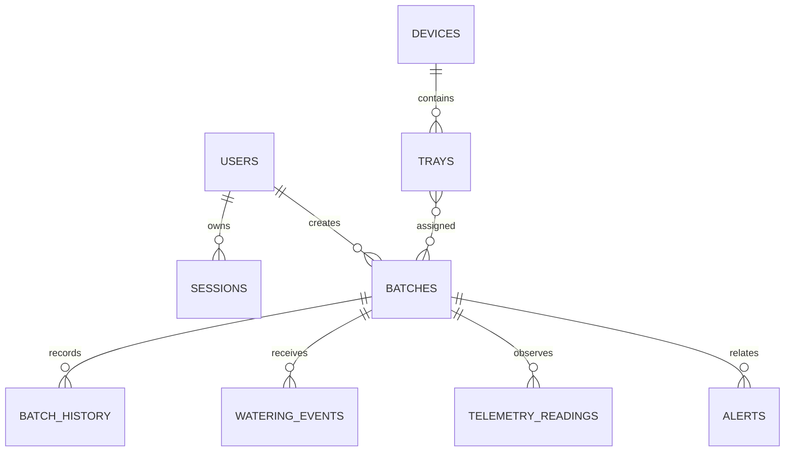

# Database Schema

## 1. Schema conventions

Every table has an immutable primary key, creation time, and explicit foreign
keys. UTC timestamps use timezone-aware columns. Status values are constrained
in application validation and, where stable, in database checks. Operational
records are retained for traceability rather than overwritten.

## 2. Entity relationship model

## 3. Core tables

| Table | Purpose | Important fields |
| --- | --- | --- |
| `users` | Google identity and role | `google_subject`, `email`, `role`, `is_active` |
| `sessions` | Expiring server sessions | `token_hash`, `user_id`, `expires_at` |
| `devices` | Future ESP32 identity | `device_id`, `name`, `status`, `last_seen_at` |
| `trays` | Physical tray position | `device_id`, `position`, `capacity`, `is_active` |
| `batches` | Grower production unit | `owner_id`, `code`, `stage`, `status`, dates |
| `batch_history` | Immutable lifecycle changes | `batch_id`, `from_status`, `to_status`, actor |
| `watering_events` | Manual/device water records | `batch_id`, `volume_ml`, source, occurred_at |
| `telemetry_readings` | Validated conditions | `batch_id`, units, occurrence/receipt time |
| `alerts` | Operational exception lifecycle | severity, message, read/resolved state |
| `audit_events` | Security/privileged changes | actor, action, resource, metadata |

## 4. First migration slice

The current implementation adds `batches` with ownership, lifecycle fields,
indexes, and a migration. Device relationships and historical records are
separate vertical slices so the schema remains reviewable and reversible.

## MQTT telemetry slice (0013)

`devices.mqtt_topic_prefix` is nullable and globally unique. A server-only
connection request sets `connection_requested_at`; fresh telemetry sets
`last_seen_at` and online/fault status. Grants alone remain pending. Topic
bindings are cleared on ownership changes, and telemetry keeps its owner/device
foreign key. Existing devices are not automatically connected.

`telemetry_readings` now includes `received_at`, `voltage`, `sd_ok`,
`sensor_status`, and nullable `message_id`. A device/message uniqueness constraint
prevents replay when firmware supplies an identifier; a device/time index supports
recent readings. Existing history backfills receipt time from recorded time.
Missing or faulty measurements remain null. Existing RLS read policies apply;
authenticated browser roles cannot write ingestion or connection state.
Both tables are published to `supabase_realtime` when that publication exists.

## Wireless registration slice (0014)

`devices.requires_serial_number` is non-null and defaults to false for existing
devices. Server-authorized wireless registration sets it to true, requiring a
matching `serialNumber` in every MQTT sensor packet. Reconnecting through the
legacy serial form cannot disable this requirement. The API can register a new
serial for an active operator; existing serial ownership and globally unique
topic prefixes remain enforced. Discovery results/tokens expire in server memory
and are not stored as devices until the operator selects **Connect device**.
Browser roles retain their existing write restrictions. Downgrading 0014 removes
the serial requirement flag without deleting devices or sensor history.

## Working IoT archive compatibility (0015–0018)

The configured shared database was already at `0018_telemetry_rollups` when the
working IoT archive was integrated. Its missing migration files are restored
unchanged: BLE transport metadata, demo cleanup, device-alert categories, and
telemetry rollup metadata. No migration was reapplied or downgraded as part of
this integration. Revision `0016_remove_demo_workspace_data` irreversibly removes
labelled demo records and disables automatic sample seeding; review that original
migration before upgrading a different database that is still behind it.

`telemetry_readings.aggregation` distinguishes `raw`, `hourly`, and `daily` rows.
`sample_count`, `fault_count`, and per-metric counts describe what each row
represents. New packets remain raw samples, with faulty/missing sensor counts
recorded accurately. The live API returns raw rows; the workspace's authorized
history queries retain the stored rollups and label them explicitly. No automatic
retention or compaction worker is enabled by this integration.

## Field workflows (0019)

Migration `0019_field_workflows` adds `alerts.report_key` with per-owner uniqueness
for idempotent reporting, `alerts.batch_id` with a composite batch/owner foreign
key, and `notification_preferences.last_alert_seen_at` for each user's read state.
The existing preferences RLS continues to apply to the added field. A partial
index on raw telemetry by device and receipt time supports history sampling.
The API now returns current cached packets separately from saved samples.
This originally saved one sample per 60 seconds. Migration 0023 replaces that
collector behavior with adaptive averages; existing samples are retained.
See [storage and quality acceptance](telemetry-and-usability.md).

## Shared workspace search (0020)

`public.search_workspace(query_text text)` returns bounded, typed search results
and the RLS-visible record payload for web and native mobile. It runs as the
authenticated caller, uses existing policies, denies anonymous execution and
does not change table data. Literal matching spans operational records, while
historical telemetry stays outside the search scans. See
[the search contract and limits](workspace-search-and-design.md).

## Internal table security (0021)

Migration `0021_internal_table_security` enables RLS on Alembic's internal version
table and revokes anonymous and authenticated access to its migration stamp.
Access requests retain policy-filtered authenticated reads; direct client writes,
truncate and sequence grants are removed. Trusted backend operations keep their
existing access. No application records are removed. See the
[security review and verification commands](database-security-review.md).

## Evaluator workflows (0022)

The relationship is unique per `(owner_id, evaluator_email)`, with many grants
per operator and no global uniqueness on `evaluator_id`. Retrying a grant is a
successful no-op; approvals preserve grants from other operators. Operator RPCs
validate active roles and ownership and deny anonymous execution. Pending
request decisions are locked and idempotent. Existing account records remain.

## Adaptive telemetry (0023)

History adds `event`, `minute`, and `five_min` aggregation values, per-sensor
`metric_stats`, and UTC window boundaries. Existing raw/hourly/daily rows stay
unchanged. A unique partial index prevents duplicate adaptive window rows.

`device_live_state` holds one durable current packet and minute preview per
device, plus a private bounded accumulator and flush deadline. Its composite
device/owner foreign key preserves tenant identity; a binding-change trigger
clears transient state when ownership, topic or connection request changes.
RLS limits visible state to permitted workspaces. Authenticated clients have
column-level reads of public state only; no accumulator reads or direct writes.
`workspace_live_snapshot(after_id)` applies caller RLS and returns labelled
history separately from current packets. See the [aggregation contract](telemetry-and-usability.md).

Upgrade 0022/0023 is additive and does not rewrite old sensor history. DDL uses a
five-second lock timeout. Prefer forward fixes after activation: downgrading
0023 refuses to discard adaptive history or live accumulators, and 0022 retains
the compatible workflow fixes. The collector must be restarted after upgrade.

## Merged history compatibility (0024)

The incoming history change introduced a second migration from 0018. Its
unapplied schema change is reconciled as `0024_telemetry_history_compat` after
the already deployed 0023, keeping one Alembic head. Applied migrations 0019
through 0023 are unchanged. The column widens to 16 characters and accepts
legacy `five_minute` records alongside adaptive `five_min`, `minute`, and
`event` records. Legacy means remain labelled history, never current values.
Existing records are not rewritten; the durable adaptive collector is retained.
