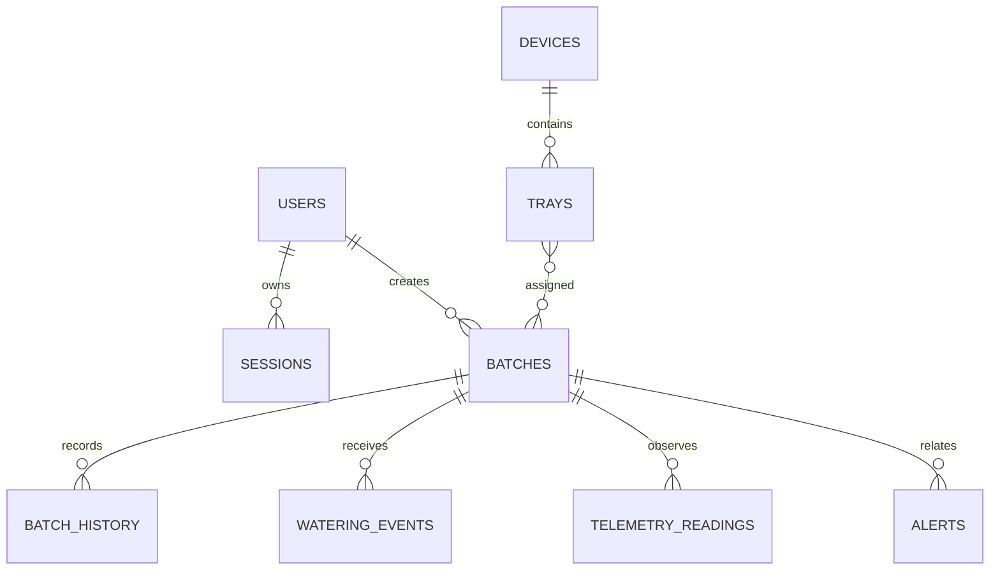

# Database Schema

## 1. Schema conventions

Every table has an immutable primary key, creation time, and explicit foreign
keys. UTC timestamps use timezone-aware columns. Status values are constrained
in application validation and, where stable, in database checks. Operational
records are retained for traceability rather than overwritten.

## 2. Entity relationship model

## 3. Core tables

| Table | Purpose | Important fields |
| --- | --- | --- |
| `users` | Google identity and role | `google_subject`, `email`, `role`, `is_active` |
| `sessions` | Expiring server sessions | `token_hash`, `user_id`, `expires_at` |
| `devices` | Future ESP32 identity | `device_id`, `name`, `status`, `last_seen_at` |
| `trays` | Physical tray position | `device_id`, `position`, `capacity`, `is_active` |
| `batches` | Grower production unit | `owner_id`, `code`, `stage`, `status`, dates |
| `batch_history` | Immutable lifecycle changes | `batch_id`, `from_status`, `to_status`, actor |
| `watering_events` | Manual/device water records | `batch_id`, `volume_ml`, source, occurred_at |
| `telemetry_readings` | Validated conditions | `batch_id`, units, occurrence/receipt time |
| `alerts` | Operational exception lifecycle | severity, message, read/resolved state |
| `audit_events` | Security/privileged changes | actor, action, resource, metadata |

## 4. First migration slice

The current implementation adds `batches` with ownership, lifecycle fields,
indexes, and a migration. Device relationships and historical records are
separate vertical slices so the schema remains reviewable and reversible.

## MQTT telemetry slice (0013)

`devices.mqtt_topic_prefix` is nullable and globally unique. A server-only
connection request sets `connection_requested_at`; fresh telemetry sets
`last_seen_at` and online/fault status. Grants alone remain pending. Topic
bindings are cleared on ownership changes, and telemetry keeps its owner/device
foreign key. Existing devices are not automatically connected.

`telemetry_readings` now includes `received_at`, `voltage`, `sd_ok`,
`sensor_status`, and nullable `message_id`. A device/message uniqueness constraint
prevents replay when firmware supplies an identifier; a device/time index supports
recent readings. Existing history backfills receipt time from recorded time.
Missing or faulty measurements remain null. Existing RLS read policies apply;
authenticated browser roles cannot write ingestion or connection state.
Both tables are published to `supabase_realtime` when that publication exists.

## Wireless registration slice (0014)

`devices.requires_serial_number` is non-null and defaults to false for existing
devices. Server-authorized wireless registration sets it to true, requiring a
matching `serialNumber` in every MQTT sensor packet. Reconnecting through the
legacy serial form cannot disable this requirement. The API can register a new
serial for an active operator; existing serial ownership and globally unique
topic prefixes remain enforced. Discovery results/tokens expire in server memory
and are not stored as devices until the operator selects **Connect device**.
Browser roles retain their existing write restrictions. Downgrading 0014 removes
the serial requirement flag without deleting devices or sensor history.
